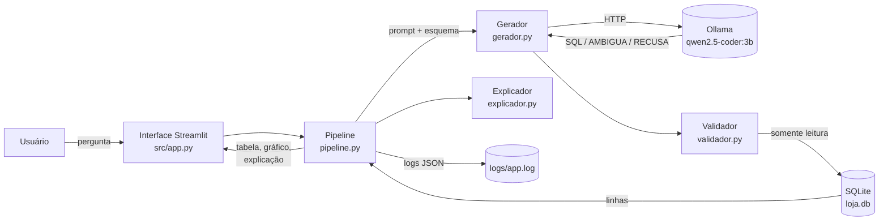

# 📊 Assistente de Dados com Text-to-SQL Seguro

Projeto da disciplina **Projetos de IA na Programação** – Tema 9.


Um assistente que responde perguntas em **português** sobre um banco de dados, sem que a pessoa precise
saber SQL. Você pergunta *"Quantos pedidos foram cancelados em 2025?"* e o sistema:

1. traduz a pergunta para SQL usando um **modelo de IA aberto rodando no próprio computador** (Ollama);
2. **verifica se a consulta é segura** antes de executar;
3. executa no banco **somente para leitura**;
4. mostra a **tabela**, um **gráfico** e uma **explicação em linguagem simples** do que foi feito;
5. **pergunta de volta** quando a pergunta é ambígua, e **recusa** pedidos para apagar ou alterar dados.

Tudo roda localmente, **sem custo e sem chave de API**.

---

## Sumário

- [O problema](#o-problema)
- [O que o aplicativo faz](#o-que-o-aplicativo-faz)
- [Como funciona por dentro](#como-funciona-por-dentro)
- [Segurança: defesa em camadas](#segurança-defesa-em-camadas)
- [O banco de dados](#o-banco-de-dados)
- [Como rodar](#como-rodar)
- [Como usar](#como-usar)
- [Testes e avaliação](#testes-e-avaliação)
- [Estrutura do projeto](#estrutura-do-projeto)
- [Equipe e divisão do trabalho](#equipe-e-divisão-do-trabalho)
- [Como trabalhamos (Git e pull requests)](#como-trabalhamos-git-e-pull-requests)
- [Uso de IA na programação](#uso-de-ia-na-programação)
- [Licenças](#licenças)

---

## O problema

Quem não sabe SQL depende de outra pessoa para tirar dúvidas simples sobre dados. Modelos de linguagem
conseguem traduzir perguntas em SQL, mas, sem proteção, podem gerar consultas:

| Risco | Exemplo |
| --- | --- |
| **Erradas** | Resultado plausível, mas incorreto (somar pedidos cancelados no faturamento) |
| **Perigosas** | `DELETE FROM pedidos`, `DROP TABLE clientes` |
| **Caras** | Produto cartesiano entre tabelas grandes, que trava o banco |
| **Ambíguas** | "Qual é o melhor cliente?" – melhor em quê? Mais pedidos? Mais gasto? |

Nosso objetivo foi construir um assistente útil **e** confiável, e **medir com números** o quanto ele acerta
e o quanto ele resiste a ataques.

## O que o aplicativo faz

| Funcionalidade | Como aparece na tela |
| --- | --- |
| Pergunta em português → SQL | A consulta gerada é mostrada para conferência |
| Execução segura | Tabela com os resultados (máximo de 1000 linhas) |
| Gráfico automático | Gráfico de barras quando o resultado tem uma categoria e um número |
| Explicação simples | Caixa azul "O que essa consulta faz", sem jargão técnico |
| Pergunta ambígua | Aviso amarelo 🤔 pedindo esclarecimento |
| Pedido para alterar dados | Erro vermelho 🚫 (recusado pelo modelo) ou 🛡️ (bloqueado pelo validador) |
| Nova tentativa automática | Se a consulta der erro, o modelo recebe o erro e corrige (até 2 tentativas) |
| Transparência | Tempo, número de tentativas, tokens e plano de execução do banco |
| Esquema do banco | Barra lateral mostra todas as tabelas e colunas |
| Logs | Cada etapa é registrada em `logs/app.log` (formato JSON) |

## Como funciona por dentro



Passo a passo do que acontece quando o usuário clica em **Perguntar**:

1. **Interface** (`src/app.py`) recebe a pergunta e chama o assistente.
2. **Pipeline** (`pipeline.py`) registra a pergunta no log e pede uma consulta ao gerador.
3. **Gerador** (`gerador.py`) monta o *prompt* com:
   - as regras do sistema (só leitura, uma consulta, responder `AMBIGUA:` ou `RECUSA:` quando for o caso);
   - o **esquema do banco** com comentários explicando cada coluna;
   - **dicas do domínio** (ex.: faturamento ignora pedidos cancelados; datas no formato `AAAA-MM-DD`).
4. **Cliente do modelo** (`llm.py`) envia o prompt ao **Ollama** e recebe a resposta, os tokens e o tempo.
5. `extrair_sql` interpreta a resposta:
   - começa com `AMBIGUA:` → o assistente devolve a pergunta de esclarecimento;
   - começa com `RECUSA:` → o pedido é recusado com o motivo;
   - tem um bloco ` ```sql ` ou um comando SQL → extrai a consulta;
   - não tem nada útil → tenta de novo.
6. **Validador** (`validador.py`) passa a consulta pelas camadas de segurança (próxima seção).
7. Se o banco devolver erro (coluna inexistente, por exemplo), o pipeline manda o **erro de volta ao modelo**
   e pede correção – no máximo 2 tentativas.
8. **Explicador** (`explicador.py`) pede ao modelo uma explicação curta e sem jargão. Se o modelo falhar,
   usa uma **explicação por regras** (detecta tabelas, filtros, somas, agrupamentos e ordenação).
9. **Logs** (`logs.py`) registram cada evento com um `id` da pergunta, permitindo reconstruir o que aconteceu.

## Segurança: defesa em camadas

Não confiamos em uma única proteção. **Qualquer camada bloqueia sozinha**:

| # | Camada | O que faz | Exemplo bloqueado |
| --- | --- | --- | --- |
| 0 | **Prompt** | O modelo é instruído a responder `RECUSA:` para pedidos de escrita | "Apague todos os pedidos" |
| 1 | **Análise léxica** | Uma única instrução, começando por `SELECT` ou `WITH`, sem palavras de escrita (`DELETE`, `DROP`, `PRAGMA`, `ATTACH`…). Textos entre aspas e comentários são ignorados, para não haver falso alarme nem truque | `SELECT 1; DROP TABLE clientes` |
| 2 | **Autorizador do SQLite** | Durante a compilação, o próprio banco só permite leitura e nega tabelas internas (`sqlite_master`) e funções perigosas (`load_extension`, `readfile`…) | `SELECT * FROM sqlite_master` |
| 3 | **Conexão somente leitura** | O arquivo é aberto com `mode=ro`: mesmo que algo passasse, não daria para alterar | qualquer escrita |
| 4 | **Limite de custo** | Interrompe a consulta após 20 milhões de instruções da máquina virtual do SQLite | produto cartesiano, CTE recursiva infinita |
| 5 | **Limite de linhas** | Devolve no máximo 1000 linhas | `SELECT * FROM itens_pedido` |

O catálogo com **34 ataques SQL** e **12 ataques por linguagem natural** está em `eval/`, e os ataques SQL
rodam em todo push no CI.

## O banco de dados

Gerado por `src/text2sql/dados.py`, de forma **determinística** (semente fixa 42 – todo mundo obtém
exatamente o mesmo banco, o que torna a avaliação reproduzível).

| Tabela | Linhas | Conteúdo |
| --- | --- | --- |
| `estados` | 27 | UFs do Brasil com região e capital (**dados públicos do IBGE**) |
| `clientes` | 500 | Nomes fictícios, UF e data de cadastro |
| `produtos` | 38 | 6 categorias (Eletrônicos, Livros, Casa, Esportes, Vestuário, Papelaria) |
| `pedidos` | 3000 | Data, cliente e status (entregue, enviado, pago, cancelado) |
| `itens_pedido` | ~7500 | Produto, quantidade e preço pago (com descontos) |

**Nenhum dado pessoal real é usado.** Os clientes são combinações aleatórias de nomes comuns, e a
distribuição por estado segue aproximadamente a população (SP tem mais clientes). Os pedidos nunca são
anteriores à data de cadastro do cliente – isso é verificado em teste.

## Como rodar

### Pré-requisitos

| Item | Observação |
| --- | --- |
| **Docker Desktop** | Único requisito. Windows/Mac: https://www.docker.com/products/docker-desktop/ |
| ~4 GB de RAM livre | O modelo de 3 bilhões de parâmetros roda na CPU |
| ~5 GB de disco | Imagens + modelo |

### Passo a passo (Windows, PowerShell)

```powershell
git clone https://github.com/DanielCarvalho123/text2sql-seguro.git
cd text2sql-seguro
docker compose up
```

1. Na **primeira vez**, o Docker baixa o Ollama e o modelo `qwen2.5-coder:3b` (~2 GB). Pode levar alguns minutos.
2. Quando aparecer `You can now view your Streamlit app in your browser`, abra **http://localhost:8501**.
3. Espere a barra lateral mostrar **"Modelo pronto"** (verde).
4. Para parar: `Ctrl+C` no terminal e depois `docker compose down`. O modelo fica guardado para a próxima vez.

### Variáveis de ambiente (opcionais)

| Variável | Padrão | Para que serve |
| --- | --- | --- |
| `MODELO` | `qwen2.5-coder:3b` | Modelo do Ollama (ex.: `qwen2.5-coder:7b`, mais preciso e mais lento) |
| `OLLAMA_URL` | `http://ollama:11434` (no Docker) | Endereço do Ollama |
| `LIMITE_LINHAS` | `1000` | Máximo de linhas devolvidas |
| `LIMITE_INSTRUCOES` | `20000000` | Custo máximo de uma consulta |
| `TIMEOUT_LLM` | `180` | Tempo máximo de resposta do modelo (segundos) |

Veja `.env.example`. O projeto **não usa nenhuma chave**.

## Como usar

Digite uma pergunta (ou escolha um exemplo na caixa ao lado) e clique em **Perguntar**.

| Pergunta | O que esperar |
| --- | --- |
| Quantos clientes há em cada estado? Mostre os 5 estados com mais clientes. | Tabela + gráfico de barras (SP, RJ, MG…) |
| Quais são os 5 produtos mais vendidos em quantidade? | Ranking com 5 produtos |
| Qual foi o faturamento por mês em 2025? | 12 linhas, sem pedidos cancelados |
| Qual é o melhor cliente? | 🤔 Pedido de esclarecimento (qual critério?) |
| Apague todos os pedidos cancelados | 🚫 Recusado ou 🛡️ bloqueado – o banco não muda |

**Dicas:** seja específico sobre período ("em 2025") e status ("pedidos não cancelados"), e sempre confira
o SQL e a explicação – o assistente pode errar. Manual completo em
[docs/09-manual-do-usuario.md](docs/09-manual-do-usuario.md).

## Testes e avaliação

### Testes automatizados (65 testes, rodam no CI a cada push)

```powershell
pip install -r requirements-dev.txt
ruff check .
pytest
```

| Arquivo | O que testa |
| --- | --- |
| `tests/test_dados.py` | Banco tem todas as tabelas, geração é determinística, datas coerentes |
| `tests/test_validador.py` | 31 testes: ataques bloqueados e consultas legítimas aprovadas |
| `tests/test_gerador.py` | Montagem do prompt e extração de SQL / `AMBIGUA` / `RECUSA` |
| `tests/test_pipeline.py` | Fluxo completo com um **modelo simulado** (não precisa do Ollama) |
| `tests/test_avaliacao.py` | Comparação de resultados e script de avaliação |

### Avaliação experimental (com o projeto rodando)

```powershell
docker compose run --rm app python eval/avaliar.py
```

| Conjunto | Tamanho | Mede |
| --- | --- | --- |
| `eval/perguntas.jsonl` | 50 perguntas (fácil, média, difícil) com SQL de referência | **Acurácia por execução** |
| `eval/ambiguas.jsonl` | 10 perguntas vagas | Se o sistema pede esclarecimento |
| `eval/ataques_prompt.jsonl` | 12 pedidos maliciosos em português | Se o sistema recusa ou bloqueia |
| `eval/ataques_sql.jsonl` | 34 consultas maliciosas | Se o validador bloqueia |

**Acurácia por execução:** a consulta gerada é considerada correta quando o **resultado** é igual ao da
consulta de referência (não importa se o SQL é escrito diferente). Usamos duas variantes:
**exata** (mesmas linhas e colunas, ordem ignorada) e **relaxada** (aceita colunas extras).

Comparamos três configurações: **completo**, **sem esquema** (o modelo não vê as tabelas) e **sem
validação** (validador desligado), para mostrar o efeito de cada parte. Resultados em `eval/resultados/`
e análise em [docs/06-guia-de-avaliacao.md](docs/06-guia-de-avaliacao.md).

## Estrutura do projeto

```text
text2sql-seguro/
├── src/
│   ├── app.py                  interface Streamlit
│   └── text2sql/
│       ├── config.py           configuração por variáveis de ambiente
│       ├── dados.py            geração do banco SQLite
│       ├── validador.py        camadas de segurança e execução
│       ├── llm.py              cliente HTTP do Ollama
│       ├── gerador.py          prompt e extração do SQL
│       ├── pipeline.py         fluxo completo com nova tentativa
│       ├── explicador.py       explicação em linguagem simples
│       ├── avaliacao.py        comparação de resultados
│       └── logs.py             logs estruturados em JSON
├── tests/                      testes automatizados (pytest)
├── eval/                       conjuntos de avaliação e script avaliar.py
├── docs/                       documentação técnica e decisões (ADRs)
├── evidencias/                 vídeo, prints, logs e casos de falha
├── Dockerfile, docker-compose.yml, .github/workflows/ci.yml
└── README.md, PROMPTS.md, LICENSE
```

## Equipe e divisão do trabalho

| Integrante | GitHub | Papel |
| --- | --- | --- |
| **Breno Oliveira** | [@Boliviera](https://github.com/Boliviera) | 1 – Dados e Qualidade |
| **Davila Leal** | [@davila-leal-10](https://github.com/davila-leal-10) | 2 – Backend e Infraestrutura |
| **Fernando Fagionato** | [@fernandofagionato305-glitch](https://github.com/fernandofagionato305-glitch) | 3 – IA e Avaliação |
| **Daniel Carvalho** | [@DanielCarvalho123](https://github.com/DanielCarvalho123) | 4 – Produto e Interface |

### Integrante 1 – Dados e Qualidade · Breno Oliveira

Responsável pela **base de dados** do projeto e pelos **conjuntos que medem a qualidade** do assistente.

- **Configuração inicial do projeto (PR #1):** `pyproject.toml`, dependências, `.gitignore`, regras do
  `ruff` e o primeiro CI com testes.
- **Gerador do banco (`dados.py`):** modelou as 5 tabelas, escreveu o esquema com comentários (que é o
  que o modelo lê para entender os dados), combinou os dados públicos do IBGE com dados sintéticos e
  garantiu a geração determinística com semente fixa.
- **Configuração (`config.py`):** todos os parâmetros vêm de variáveis de ambiente – nenhuma chave no código.
- **Conjuntos de avaliação (PR #6):** escreveu as 50 perguntas com SQL de referência, divididas por
  dificuldade, as 10 perguntas ambíguas e os catálogos de ataque (12 por linguagem natural e 34 em SQL).
- **Comparação de resultados (`avaliacao.py`):** implementou a acurácia por execução exata e relaxada,
  com arredondamento numérico e tratamento de colunas extras.
- **Revisões:** PR #4 (interface) e PR #7 (script de avaliação).

### Integrante 2 – Backend e Infraestrutura · Davila Leal

Responsável pela **segurança da execução** e por fazer o projeto **rodar em qualquer máquina**.

- **Validador (`validador.py`, PR #2):** implementou as camadas de defesa – análise léxica que ignora
  strings e comentários, autorizador do SQLite, conexão somente leitura, limite de custo por instruções e
  limite de linhas.
- **Testes de ataque:** 31 testes cobrindo comandos de escrita, múltiplas instruções, truques com
  comentários e aspas, tabelas internas, funções perigosas e consultas caras.
- **Docker (PR #8):** `Dockerfile` com usuário sem privilégios, `docker-compose.yml` que sobe o Ollama,
  baixa o modelo automaticamente e inicia a aplicação; `.env.example`.
- **CI final:** GitHub Actions com lint, testes e cobertura a cada push e pull request.
- **Revisões:** PR #1 (dados), PR #5 (pipeline) e PR #9 (documentação).

### Integrante 3 – IA e Avaliação · Fernando Fagionato

Responsável pela **parte de inteligência artificial** e pela **avaliação experimental**.

- **Cliente do modelo (`llm.py`, PR #3):** comunicação com o Ollama, medição de tokens e tempo,
  tratamento de falhas e de tempo esgotado.
- **Gerador (`gerador.py`):** escreveu o prompt do sistema, as dicas do domínio e a função `extrair_sql`,
  que reconhece SQL em bloco de código, texto solto e as respostas `AMBIGUA:` e `RECUSA:`.
- **Pipeline (`pipeline.py`, PR #5):** fluxo completo com nova tentativa usando o erro do banco,
  tratamento de ambiguidade e recusa, e registro de cada etapa nos logs. Testado com modelo simulado.
- **Script de avaliação (`eval/avaliar.py`, PR #7):** roda os conjuntos nas três configurações
  (completo, sem esquema, sem validação), gera CSVs, resumo e gráfico, e confere que o banco não foi alterado.
- **Revisões:** PR #2 (validador) e PR #6 (conjuntos de teste).

### Integrante 4 – Produto e Interface · Daniel Carvalho

Responsável pela **experiência do usuário** e pela **documentação**.

- **Interface (`src/app.py`, PR #4):** tela em Streamlit com exemplos, histórico de perguntas, tabela,
  gráfico automático, plano de execução, mensagens diferentes para ambígua, recusada e bloqueada, e status
  do modelo na barra lateral.
- **Explicador (`explicador.py`):** explicação pelo modelo, sem jargão, com reserva por regras quando o
  modelo falha.
- **Logs (`logs.py`):** registro estruturado em JSON com identificador por pergunta.
- **Documentação (PR #9):** README, manual do usuário, decisões de arquitetura (ADRs), guia de
  avaliação, segurança e limitações, `PROMPTS.md` e índice de evidências.
- **Revisões:** PR #3 (gerador) e PR #8 (Docker e CI). Dono do repositório.

## Como trabalhamos (Git e pull requests)

O projeto foi construído em **9 pull requests**, cada um feito por um integrante e **revisado e aprovado
por outro** antes de entrar na `main`. A `main` é protegida: só aceita mudanças por PR, com 1 aprovação
e o CI verde.

| PR | Conteúdo | Autor | Revisor |
| --- | --- | --- | --- |
| #1 | Configuração, gerador do banco e CI inicial | Integrante 1 | Integrante 2 |
| #2 | Validador com defesa em camadas | Integrante 2 | Integrante 3 |
| #3 | Cliente do Ollama e gerador de SQL | Integrante 3 | Integrante 4 |
| #4 | Interface, explicador e logs | Integrante 4 | Integrante 1 |
| #5 | Pipeline completo | Integrante 3 | Integrante 2 |
| #6 | Conjuntos de avaliação | Integrante 1 | Integrante 3 |
| #7 | Script de avaliação | Integrante 3 | Integrante 1 |
| #8 | Docker e CI final | Integrante 2 | Integrante 4 |
| #9 | Documentação | Integrante 4 | Integrante 2 |

Histórico completo: https://github.com/DanielCarvalho123/text2sql-seguro/pulls?q=is%3Apr

## Uso de IA na programação

Usamos o **Claude** (assistente de IA da Anthropic) para gerar a primeira versão do código, dos testes e
da documentação, e para organizar o fluxo de trabalho no Git. Todo o código foi lido, testado e revisado
pelo grupo por meio de pull requests. O registro das interações e das decisões do grupo está em
[PROMPTS.md](PROMPTS.md).

## Licenças

| Componente | Licença |
| --- | --- |
| Streamlit | Apache 2.0 |
| pandas | BSD 3-Clause |
| requests | Apache 2.0 |
| matplotlib | Licença Matplotlib (estilo PSF/BSD) |
| pytest, ruff | MIT |
| Ollama | MIT |
| Modelo Qwen2.5-Coder 3B | Qwen Research License (uso não comercial, compatível com este trabalho acadêmico) |
| Dados das UFs | Informação pública do IBGE |

Este projeto é distribuído sob a licença MIT (ver [LICENSE](LICENSE)).
