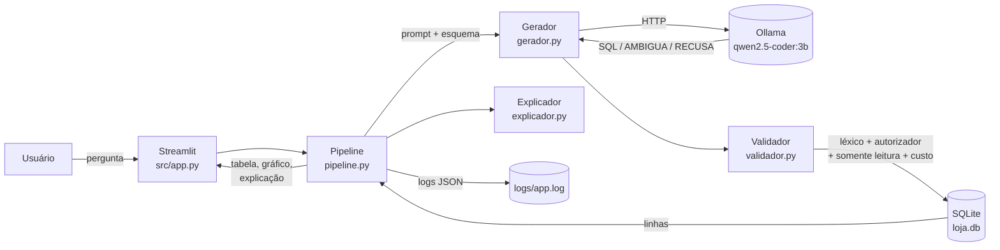

# Assistente de dados com text-to-SQL seguro

Projeto da disciplina **Projetos de IA na Programação**, Tema 9.


## Problema

Quem não sabe SQL depende de outra pessoa para tirar dúvidas simples sobre dados ("quantos pedidos
foram cancelados em 2025?"). Modelos de linguagem conseguem traduzir perguntas em SQL, mas, sem
proteção, podem gerar consultas **erradas** (resultado plausível, porém incorreto), **perigosas**
(`DELETE`, `DROP`) ou **caras** (produtos cartesianos que travam o banco).

Este projeto constrói um assistente que:

1. traduz a pergunta em português para SQL usando um **modelo aberto rodando localmente** (Ollama, custo zero);
2. **valida** a consulta antes de executar (somente leitura, uma instrução, limite de linhas e de custo);
3. **explica** a consulta em linguagem simples;
4. **pergunta** quando a pergunta é ambígua ("qual é o melhor cliente?");
5. é **avaliado com números**: acurácia por execução em 50 perguntas, comparação com baselines e catálogo de ataques.

## Arquitetura



Detalhes em [docs/01-visao-geral.md](docs/01-visao-geral.md).

## Como rodar

Pré-requisito: **Docker** (Docker Desktop no Windows/Mac). Nada é pago e não há chave de API.

```bash
git clone https://github.com/USUARIO/text2sql-seguro.git
cd text2sql-seguro
docker compose up
```

Abra **http://localhost:8501**. Na primeira vez o modelo (~2 GB) é baixado; aguarde a barra lateral
mostrar "Modelo pronto".

### Variáveis de ambiente (opcionais)

| Variável | Padrão | Para que serve |
| --- | --- | --- |
| `MODELO` | `qwen2.5-coder:3b` | Modelo do Ollama |
| `OLLAMA_URL` | `http://ollama:11434` (no Docker) | Endereço do Ollama |
| `LIMITE_LINHAS` | `1000` | Máximo de linhas devolvidas |
| `LIMITE_INSTRUCOES` | `20000000` | Custo máximo da consulta (instruções da VM do SQLite) |
| `TIMEOUT_LLM` | `180` | Tempo máximo de resposta do modelo (s) |

Veja `.env.example`. O projeto **não usa nenhuma chave**.

### Testes e avaliação

```bash
# testes (sem Docker)
pip install -r requirements-dev.txt
pytest

# avaliação completa (com o projeto no ar)
docker compose run --rm app python eval/avaliar.py
```

Os resultados vão para `eval/resultados/` (ver [docs/06-guia-de-avaliacao.md](docs/06-guia-de-avaliacao.md)).

## Estrutura

```text
src/app.py               interface Streamlit
src/text2sql/            dados, validador, gerador, llm, explicador, pipeline, avaliacao, logs
tests/                   testes automatizados (pytest)
eval/                    perguntas, catálogos de ataque e script de avaliação
evidencias/              vídeo, prints, logs e índice das evidências
docs/                    documentação técnica e pesquisa ABNT (PDF)
```

## Contribuição de cada integrante

| Integrante | Papel | Principais contribuições |
| --- | --- | --- |
| NOME 1 | Dados e Qualidade | Banco de dados, 50 perguntas de teste, testes automatizados |
| NOME 2 | Backend e Infraestrutura | Docker, CI, validador e execução segura |
| NOME 3 | IA e Avaliação | Prompts, gerador, pipeline, script de avaliação e análise de erros |
| NOME 4 | Produto e Interface | Interface Streamlit, explicador, documentação e vídeo |

## Uso de IA na programação

Ferramentas usadas: **Claude** (assistente de IA da Anthropic) para gerar a primeira versão do
código, dos testes e da documentação; **ATUALIZAR: outras ferramentas usadas pelo grupo**.
Todo o código foi revisado pelo grupo via pull request. O registro está em [PROMPTS.md](PROMPTS.md).

## Licenças de terceiros

| Componente | Licença |
| --- | --- |
| Streamlit | Apache 2.0 |
| pandas | BSD 3-Clause |
| requests | Apache 2.0 |
| matplotlib | Licença Matplotlib (estilo PSF/BSD) |
| pytest, ruff | MIT |
| Ollama | MIT |
| Modelo Qwen2.5-Coder 3B | Qwen Research License (uso não comercial, compatível com este trabalho acadêmico). A versão 7B usa Apache 2.0 |
| Dados das UFs | Informação pública do IBGE |

Este projeto é distribuído sob a licença MIT (ver [LICENSE](LICENSE)).
