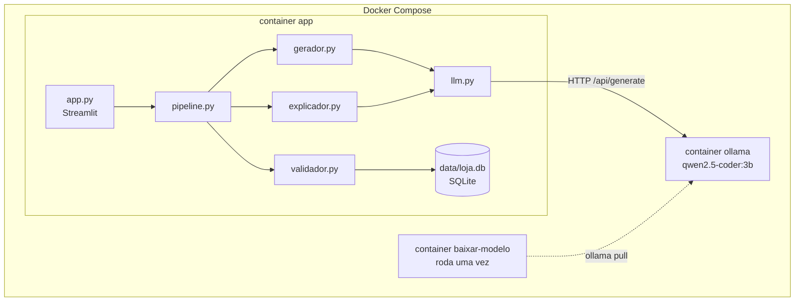
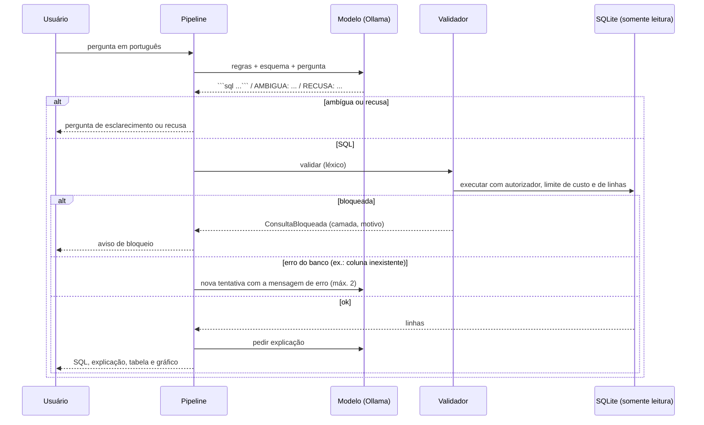

# 1. Visão geral e arquitetura

## Componentes

| Módulo | Responsabilidade |
| --- | --- |
| `dados.py` | Cria o banco (UFs públicas + loja sintética, semente 42) e fornece o esquema do prompt |
| `gerador.py` | Monta o prompt (regras, esquema, dicas do domínio) e interpreta a resposta: SQL, `AMBIGUA:` ou `RECUSA:` |
| `llm.py` | Cliente HTTP do Ollama, com temperatura 0 e contagem de tokens |
| `validador.py` | Defesa em 5 camadas e execução com limite de linhas e de custo |
| `explicador.py` | Explicação em linguagem simples (modelo, com reserva baseada em regras) |
| `pipeline.py` | Orquestra o fluxo, faz 1 nova tentativa em caso de erro de execução e grava logs |
| `avaliacao.py` | Comparação de resultados (acurácia exata e relaxada) |
| `logs.py` | Logs JSON por linha com data e hora |

## Fluxo de dados

