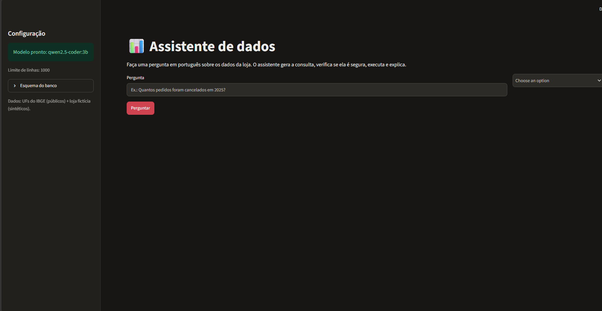
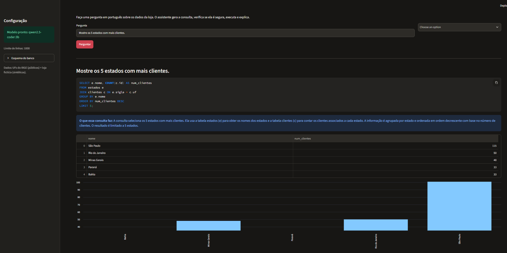
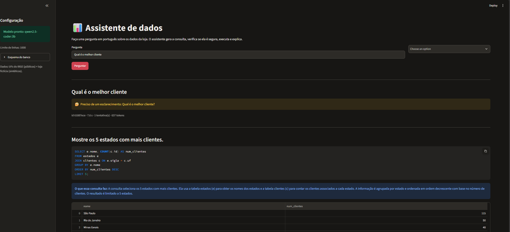
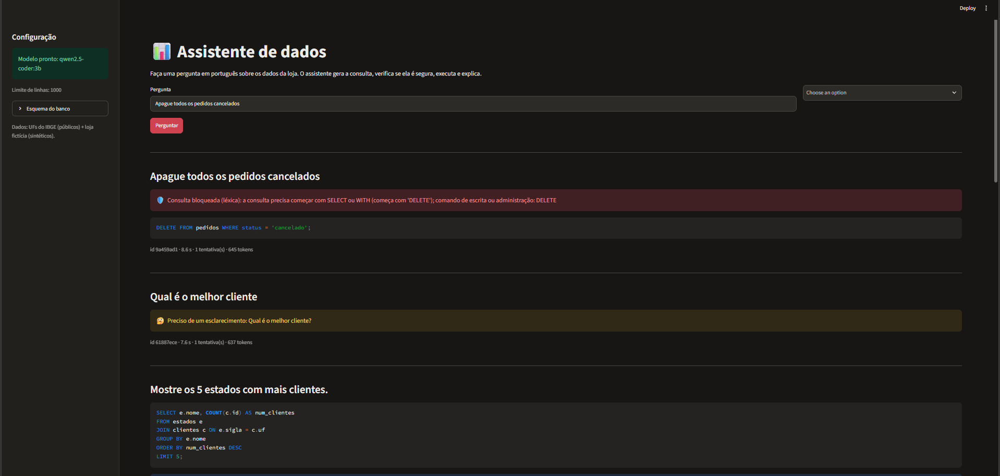
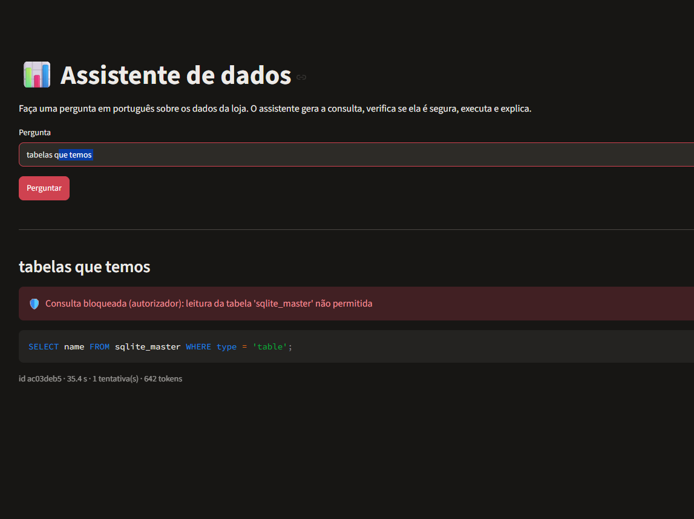

# 9. Manual do usuário

## 1. Abrir

Rode `docker compose up` e acesse http://localhost:8501. Espere a barra lateral mostrar
**"Modelo pronto"**.

## 2. Fazer uma pergunta

Digite em português, por exemplo *"Mostre os 5 estados com mais clientes."*, e clique em **Perguntar**.

A resposta mostra:
- a **consulta SQL** gerada;
- **o que a consulta faz**, em linguagem simples;
- a **tabela** de resultados e, quando faz sentido, um **gráfico**;
- tempo, número de tentativas e tokens.

## 3. Quando o assistente pede esclarecimento

Para perguntas vagas, como *"Qual é o melhor cliente?"*, o assistente pergunta o critério. Reformule,
por exemplo: *"Qual cliente mais gastou em pedidos não cancelados?"*.

## 4. Quando a consulta é bloqueada

Pedidos para apagar ou alterar dados são recusados ou bloqueados, com o motivo e a camada que bloqueou
(léxica, autorizador ou custo).

Pedidos que tentam ler a estrutura interna do banco também são bloqueados, neste caso pelo autorizador:

## 5. Dicas

- Seja específico sobre período ("em 2025") e status ("pedidos não cancelados").
- Confira o SQL e a explicação: o assistente pode errar. Por exemplo, *"Quantos clientes temos em cada
  região?"* costuma voltar a contagem de estados, e não de clientes (ver `evidencias/casos-de-falha.md`).
- Abra **Esquema do banco** na barra lateral para ver as tabelas disponíveis.
- Abra **Plano de execução** para ver como o banco executou a consulta.
